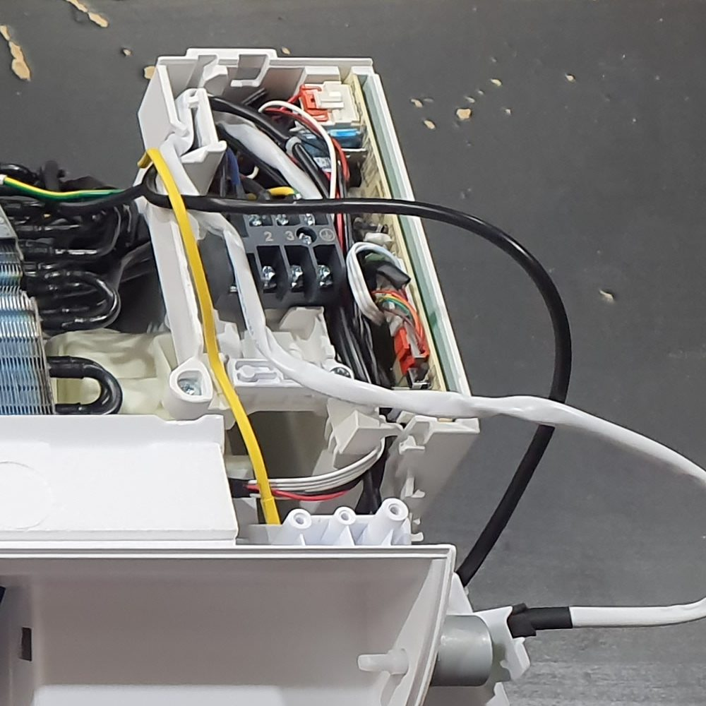
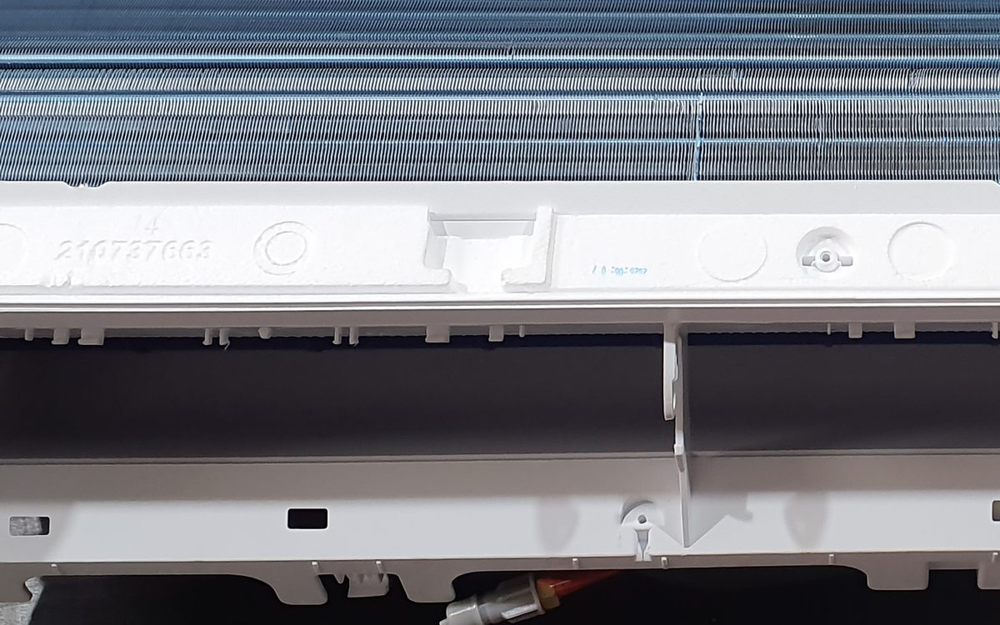

## What it is

[Two or three sentences: what the thing is and what it does.]

## Why I built it

[The problem you had, and why buying something off the shelf wasn't the answer.]

## How it works

[The design, in the order someone else would build it. Photos, CAD renders and code snippets go between paragraphs.]

*Electrical box: terminal block and control board.*

*Coil fins above the air outlet.*

## What went wrong

[Mistakes, dead ends, and what you would change next time.]
